# M.A.R.S Campus-Lost-and-Found

React + Tailwind CSS + React Router. Frontend-only application using mock data.

## Project Topic and Entities

The project topic is Campus Lost & Found. It allows students to report lost or found items across campus buildings and claim their belongings.

The main entities are:
- Items
- Locations
- Claims
- Users

## How Mock Data Simulates CRUD

The application uses mock data to simulate CRUD operations. Users can add, edit, and delete items through the interface.

All data (items, claims, users and locations) lives in React state through the shared `DataContext`, so a change on one page shows up on every other page while the app is running. Refreshing the page resets everything to the original mock data in `src/data/mockData.js`.

## Run Locally

To run the project locally:

```bash
npm install
npm run dev
```

## Routes (`src/App.jsx`)

| Path | Page | File |
|------|------|------|
| `/` | Home | `pages/Home.jsx` |
| `/items` | Item List | `pages/ItemList.jsx` |
| `/items/new` | Report an Item | `pages/ItemForm.jsx` |
| `/items/:id` | Item Details | `pages/ItemDetail.jsx` |
| `/items/:id/edit` | Edit Item | `pages/ItemForm.jsx` |
| `/claims/:id` | Claim Details | `pages/ClaimDetail.jsx` |
| `/locations/:id` | Location Details | `pages/LocationDetail.jsx` |
| `/login` | Login | `pages/Login.jsx` |
| `/register` | Register | `pages/Register.jsx` |
| `/dashboard` | My Dashboard | `pages/Dashboard.jsx` |
| `/report` | Redirects to `/items/new` | |
| `*` | 404 Page | `pages/NotFound.jsx` |

## Shared Tools

- **Data:** `useData()` from `context/DataContext.jsx` provides access to items, users, claims, and locations.
- **Login State:** `useAuth()` from `context/AuthContext.jsx` provides:
  `{ currentUser, login(email, password), logout(), register(form), emailExists(email) }`.
  The `login` function returns the user or `null` if the email or password is incorrect.
  Demo accounts are available in `mockData.js` (password: `password123`).
- **Theme:** `useTheme()` from `context/ThemeContext.jsx` provides `{ theme, toggleTheme }`.
  Use `dark:` classes to support dark mode.
- **Colors:** Defined in `src/index.css`, based on the project palette:
  - `brand-50` to `brand-950` (greens, with `brand-800` = `#244B3C`)
  - `cream` (`#F7F5EC`)
  - `line` (`#DCE6D8`)
  - `ink` (headings)
  - `body` (text)
  - `muted` (`#68796C`)
  - `night-700` to `night-950` (dark mode)

Ready-made classes include: `btn-primary`, `btn-secondary`, `btn-danger`, `btn-danger-outline`, `card`, `form-label`, `form-input`, `form-error`, `display`, `eyebrow`, `pill`, and `pill-active`.

## Deployment

The project includes `vercel.json` (Vercel) and `public/_redirects` (Netlify) to redirect routes to `index.html`. This allows pages such as `/items/3` to work when refreshed.

### Vercel
1. Push the project to GitHub.
2. Visit Vercel and select **Add New Project**.
3. Import the GitHub repository.
4. Select **Vite** as the framework.
5. Set the build command to `npm run build`.
6. Set the output directory to `dist`.
7. Deploy.

### Netlify
1. Push the project to GitHub.
2. Visit Netlify and select **Add New Site**.
3. Import the Git repository.
4. Set the build command to `npm run build`.
5. Set the publish directory to `dist`.
6. Deploy.

## Screenshots

All screenshots are in `docs/screenshots/`.

| Homepage | Item List with search and filters |
|---|---|
| 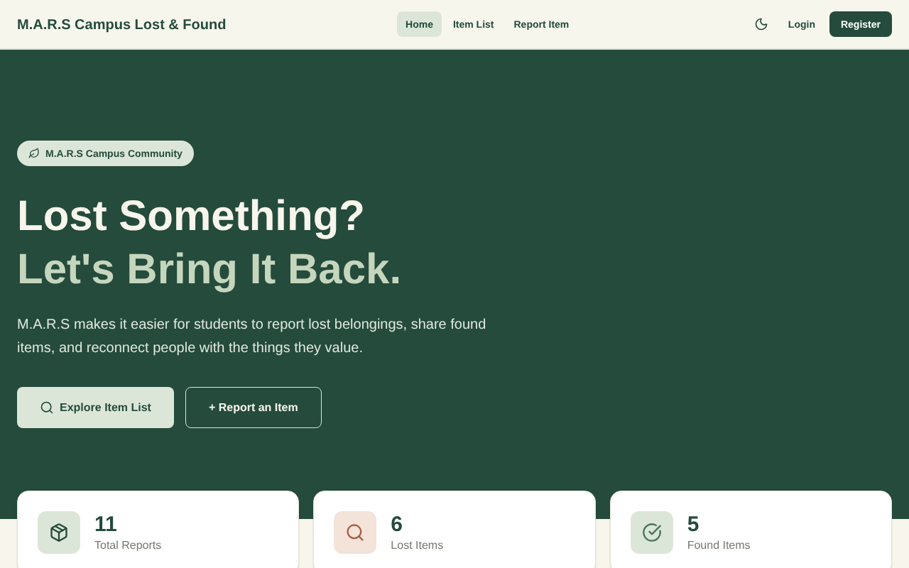 | 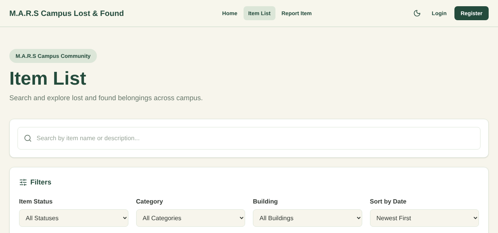 |
| **Item Details** | **Report an Item form** |
| 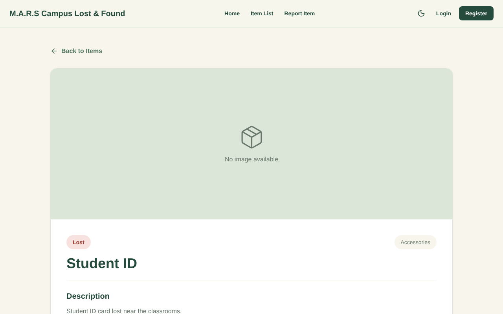 | 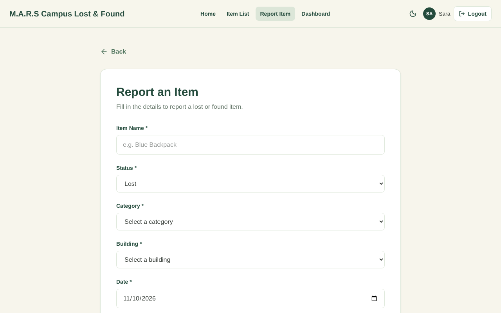 |
| **Location Details** | **Claim Details** |
| 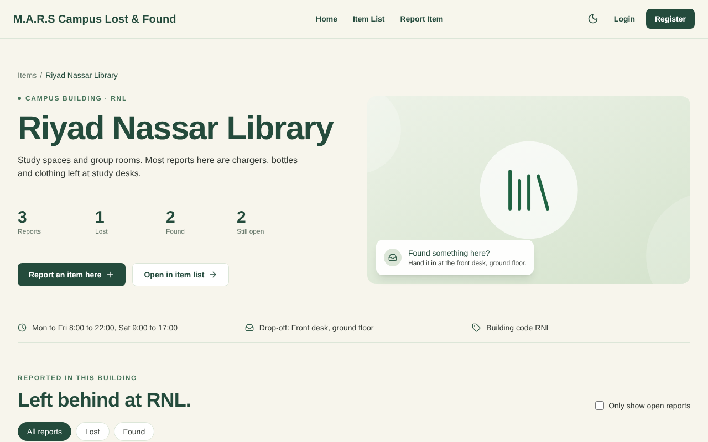 | 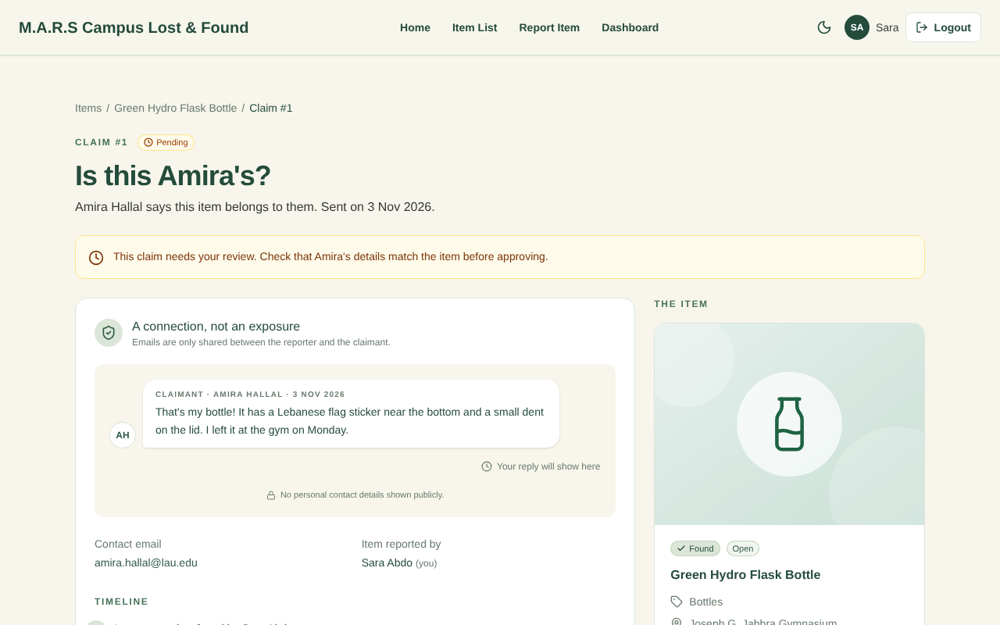 |
| **Approving a claim (modal)** | **Dashboard** |
| 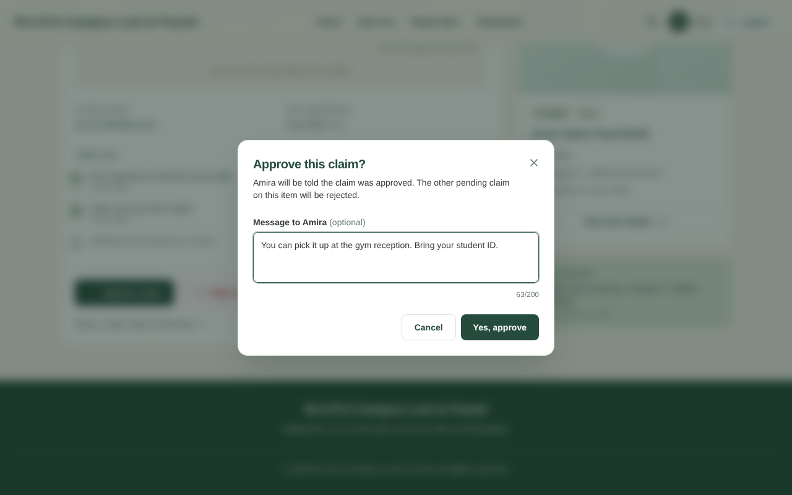 | 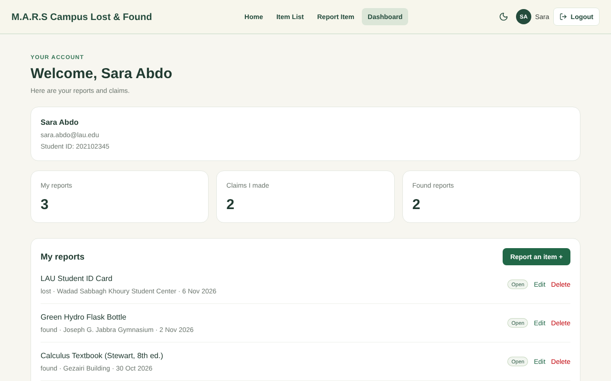 |
| **Login (wrong password)** | **Register (form validation)** |
| 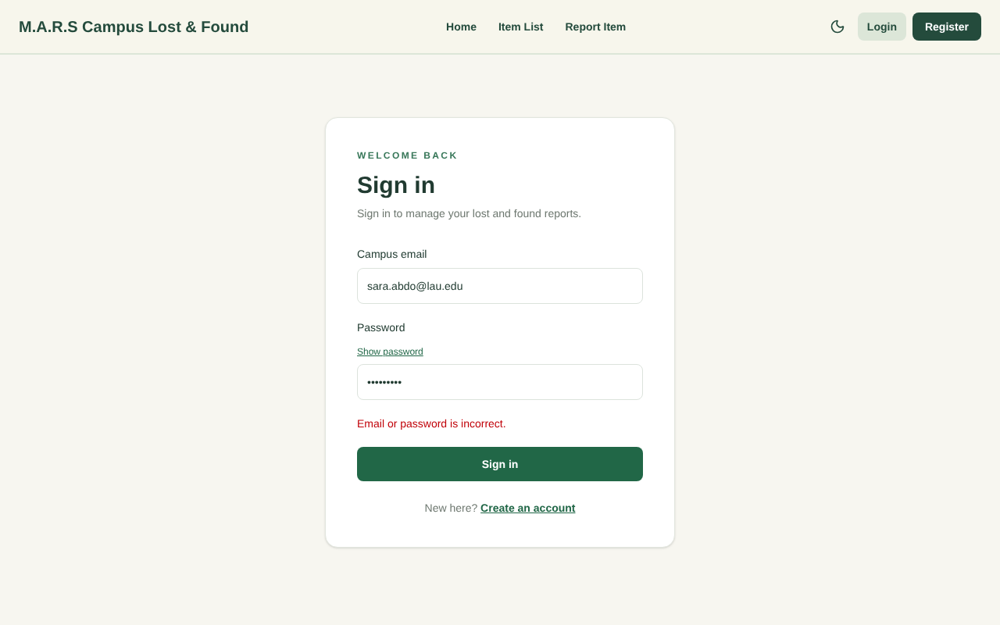 | 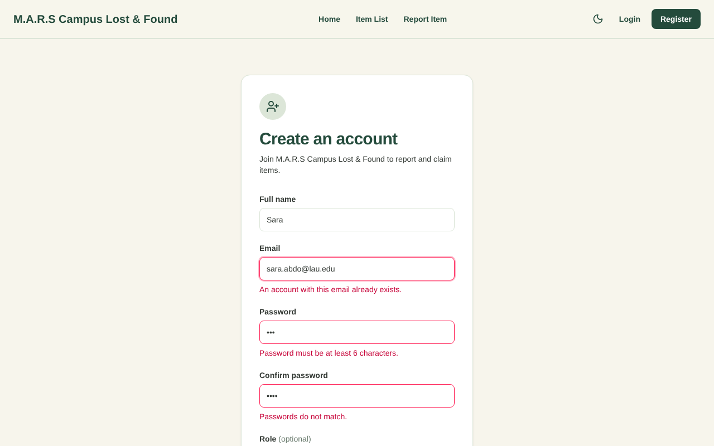 |
| **Dark mode** | |
| 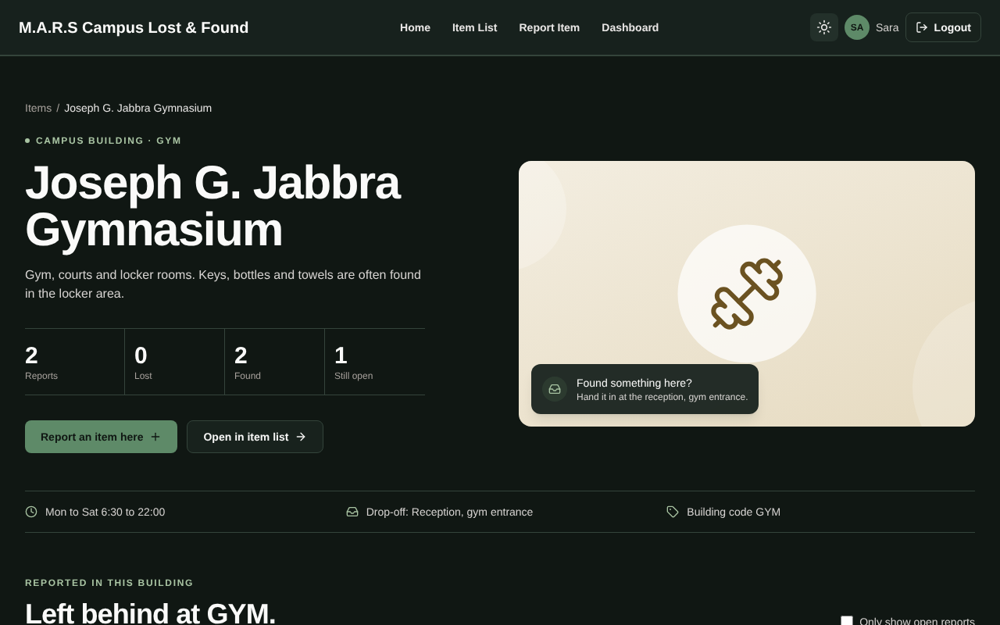 | |

**On a phone**

| Homepage | Location Details |
|---|---|
| 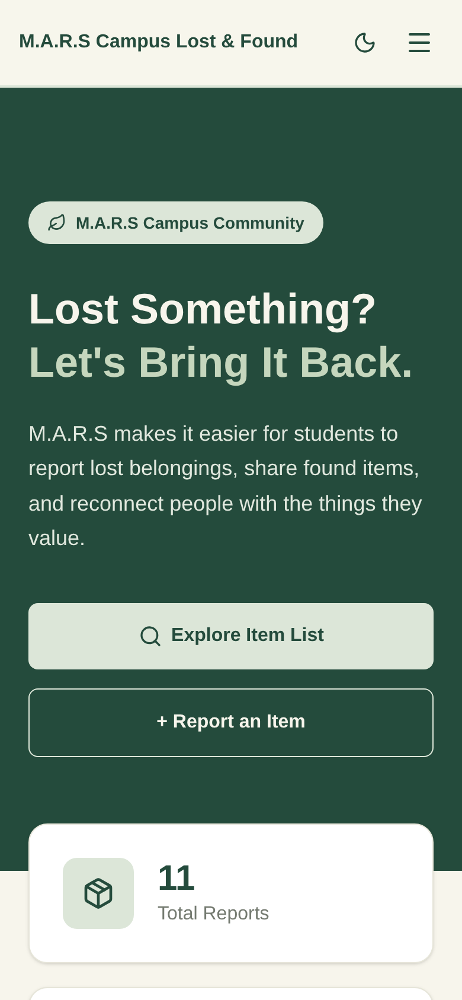 | 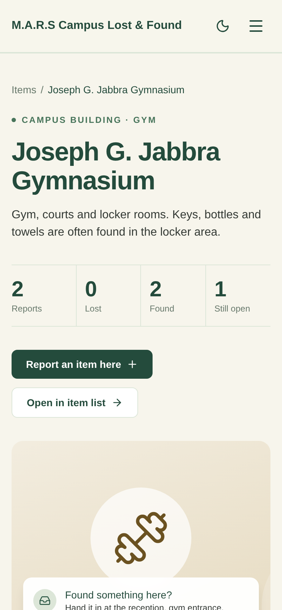 |

## Team

| Member | Name | Parts |
|--------|------|-------|
| M1 | Roua Youness | Homepage (`/`): designed the homepage layout, hero section, statistics displaying total reports, lost items, and found items, Recent Reports section, and call-to-action section. Connected homepage content to item data. Developed reusable Item Cards displaying item images and information, and connected them to individual item details pages. Implemented simulated item management (adding, editing, and deleting items) using React Context. Developed the reusable Add/Edit Item form with required-field validation. |
| M2 | Sara Abdo | Item List (`/items`), Claim Details (`/claims/:id`), and Location Details (`/locations/:id`). Mock data (`mockData.js`), shared state (`DataContext`), reusable Modal, and ItemTile card. |
| M3 | Amira Hallal |Login (/login): email and password validation, show/hide password, and sign-in using the shared authentication state. My Reports & Claims Dashboard (/dashboard): displays the signed-in user’s profile, reports they posted, claims they made, and claims on their reports, with links to edit or delete reports and view claim details.|
| M4 | Mariam Abadi | Navbar (links, mobile hamburger menu, login/logout state, and theme toggle), routes in `App.jsx`, Item Details (`/items/:id`), Register (`/register`), 404 page, and deployment. |