# M.A.R.S Campus-Lost-and-Found

**Live site:** https://campus-lost-and-found-pink-six.vercel.app

React + Tailwind CSS + React Router frontend, with an Express + MongoDB API (Phase 2) in `server/`. The React app reads and saves all data through the API.

## Project Topic and Entities

The project topic is Campus Lost & Found. It allows students to report lost or found items across campus buildings and claim their belongings.

The main entities are:
- Items
- Locations
- Claims
- Users

## How the Frontend Uses the API (Phase 2)

The React app no longer uses mock data. Everything comes from the API:

- **Loading:** when the app opens, `DataContext` loads items, claims and locations from the API. A loading message shows while it waits, and if the server can't be reached an error appears with a **Try again** button (`components/DataGate.jsx`).
- **Saving:** reporting, editing and closing items, sending, approving, rejecting and withdrawing claims, logging in and registering are all API requests. Buttons show "Saving...", "Sending..." and so on while waiting, and can't be clicked twice.
- **Feedback:** after each action a short success or error message appears in the corner (`context/FeedbackContext.jsx`). Server validation errors are shown next to the matching form field (for example "description must be at least 10 characters").
- **Signing in:** the API returns a token, which is saved in the browser so a page refresh keeps you signed in. It's sent with every request as `Authorization: Bearer <token>`. If it expires, you're signed out with a message.
- `src/data/mockData.js` is now only used by `npm run seed` to fill the database. The option lists (categories, statuses) live in `src/data/constants.js`.

## Run Locally

You need Node.js 20.19 or newer and a MongoDB database (MongoDB Atlas free tier works).

**1. Start the API** (first terminal):

```bash
cd server
npm install
cp .env.example .env      # then put your MongoDB address in server/.env
npm run seed              # first time only: fills the database with the demo data
npm run dev
```

The API runs at `http://localhost:4000`. Swagger docs: `http://localhost:4000/api-docs`.

**2. Start the website** (second terminal, in the project folder):

```bash
npm install
npm run dev
```

Open `http://localhost:5173`. The website calls the API at `http://localhost:4000` by default. To use a different address, copy `.env.example` to `.env` and change `VITE_API_URL`.

Demo accounts (after seeding): `sara.abdo@lau.edu`, `mariam.abadi@lau.edu`, `amira.hallal@lau.edu`, `roua.youness@lau.edu`, all with password `password123`.

Never commit `.env` files: they hold the database password and secrets.

## Phase 2 API

The Express API is in `server/`. See [`server/README.md`](server/README.md) for every endpoint. Responses use `{ data, meta }` for success and `{ error: { code, message, details?, requestId } }` for errors.

| Area | Endpoints | Used by |
|------|-----------|---------|
| Items | `GET/POST /api/items`, `GET/PATCH/DELETE /api/items/:id` | Home, Item List, Item Details, Report/Edit form, Dashboard |
| Locations | `GET /api/locations`, `GET /api/locations/:id` | Item List filters, Location Details, Report form |
| Claims | `GET/POST /api/claims`, `GET/PATCH/DELETE /api/claims/:id`, `POST /api/claims/:id/approve`, `/reject`, `/withdraw` | Item Details, Claim Details, Dashboard |
| Sign-in | `POST /api/auth/register`, `POST /api/auth/login`, `GET /api/auth/me` | Register, Login, Navbar (keeps you signed in) |
| Users | `GET /api/users/:id` (public name only) | "Posted by" and claimant names |

**Sign-in format the frontend expects** (`context/AuthContext.jsx`):

| Request | Body | Success response |
|---------|------|------------------|
| `POST /api/auth/register` | `{ name, email, password, role? }` | `201 { data: { token, user } }`, or `409` if the email is already used |
| `POST /api/auth/login` | `{ email, password }` | `200 { data: { token, user } }`, or `401` if the email or password is wrong |
| `GET /api/auth/me` | header `Authorization: Bearer <token>` | `200 { data: user }`, or `401` if the token is invalid |
| `GET /api/users/:id` | | `200 { data: { id, name, role, joinedAt } }` (no email or password) |

`user` is `{ id, name, email, role, joinedAt }` with a numeric `id`, and never includes the password or its hash.

## Routes (`src/App.jsx`)

| Path | Page | File |
|------|------|------|
| `/` | Home | `pages/Home.jsx` |
| `/items` | Item List with search, category, building, date and status filters | `pages/ItemList.jsx` |
| `/items/new` | Report an Item | `pages/ItemForm.jsx` |
| `/items/:id` | Item Details | `pages/ItemDetail.jsx` |
| `/items/:id/edit` | Edit Item | `pages/ItemForm.jsx` |
| `/claims/:id` | Claim Details | `pages/ClaimDetail.jsx` |
| `/locations/:id` | Location Details | `pages/LocationDetail.jsx` |
| `/login` | Login | `pages/Login.jsx` |
| `/register` | Register | `pages/Register.jsx` |
| `/dashboard` | My Dashboard | `pages/Dashboard.jsx` |
| `/report` | Redirects to `/items/new` | |
| `*` | 404 Page | `pages/NotFound.jsx` |

## Shared Tools

- **API calls:** `api.get/post/patch/delete(path, body)` from `api/client.js`. It adds the sign-in token and throws an `ApiError` with a readable `message` (plus `status`, `code`, `details`) when something fails.
- **Data:** `useData()` from `context/DataContext.jsx` holds the items, claims and locations loaded from the API (`status`, `loadError` and `reload()` describe the loading). Its change functions (`addItem`, `updateItem`, `deleteItem`, `addClaim`, `updateClaimStatus`, `withdrawClaim`) call the API and return Promises: `await` them and show `error.message` if they fail. The compatibility `useItems()` hook translates older form fields into this shared item state.
- **Login State:** `useAuth()` from `context/AuthContext.jsx` provides:
  `{ currentUser, authChecking, login(email, password), logout(), register(form) }`.
  `login` resolves to the user, or `null` if the email or password is incorrect. `register` resolves to the new, signed-in user, or throws (status `409` if the email is taken).
- **Feedback:** `useFeedback()` from `context/FeedbackContext.jsx` provides `notify(message, "success" | "error")` to show a short message in the corner.
- **Theme:** `useTheme()` from `context/ThemeContext.jsx` provides `{ theme, toggleTheme }`. Shared pages use palette tokens in `src/index.css` and Tailwind `dark:` classes.
- **Colors:** Defined in `src/index.css`, based on the project palette:
  - `brand-50` to `brand-950` (greens, with `brand-800` = `#244B3C`)
  - `cream` (`#F7F5EC`)
  - `line` (`#DCE6D8`)
  - `ink` (headings)
  - `body` (text)
  - `muted` (`#68796C`)
  - `night-700` to `night-950` (dark mode)

Ready-made classes include: `btn-primary`, `btn-secondary`, `btn-danger`, `btn-danger-outline`, `card`, `form-label`, `form-input`, `form-error`, `display`, `eyebrow`, `pill`, and `pill-active`.

## Deployment

The website and the API are deployed separately.

### API (for example on Render)
1. Create a **Web Service** from the GitHub repo with root directory `server`, build command `npm install` and start command `npm start`.
2. Add environment variables in the host's settings (never in GitHub): `MONGODB_URI`, the JWT secret used by the sign-in code, and `FRONTEND_ORIGIN` = the Vercel address (e.g. `https://campus-lost-and-found-pink-six.vercel.app`).
3. In MongoDB Atlas, under **Network Access**, allow the host to connect.
4. The server must listen on all network addresses for the host to reach it: `server/src/server.js` currently listens on `127.0.0.1`, which only works locally.

### Website (Vercel)
1. In the Vercel project, open **Settings → Environment Variables** and add `VITE_API_URL` = the API address (e.g. `https://mars-api.onrender.com`).
2. Redeploy. Vercel builds with `npm run build` and serves `dist`.

`vercel.json` (Vercel) and `public/_redirects` (Netlify) send every URL to `index.html`, so pages like `/items/3` work when refreshed.

## Screenshots

All screenshots are in `docs/screenshots/`.

| Homepage | Item List with search and filters |
|---|---|
| 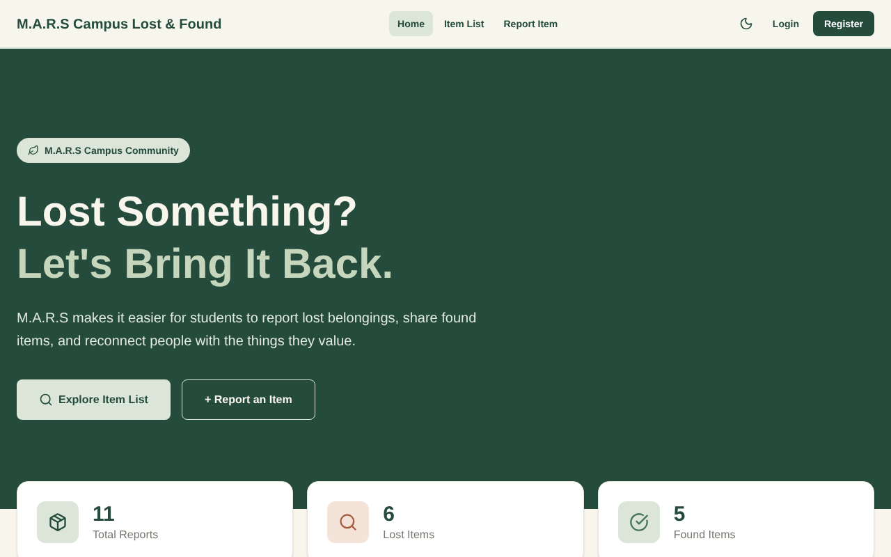 | 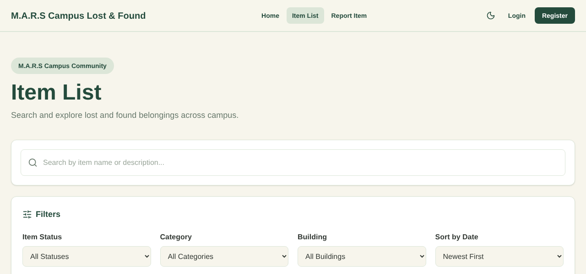 |
| **Item Details** | **Report an Item form** |
| 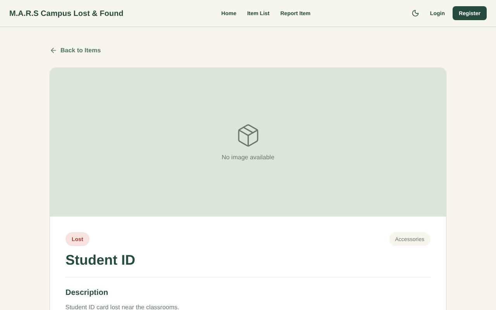 | 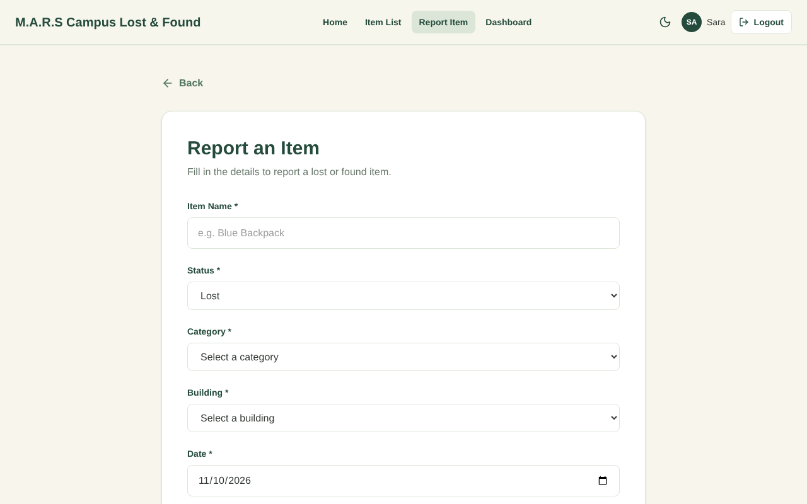 |
| **Location Details** | **Claim Details** |
| 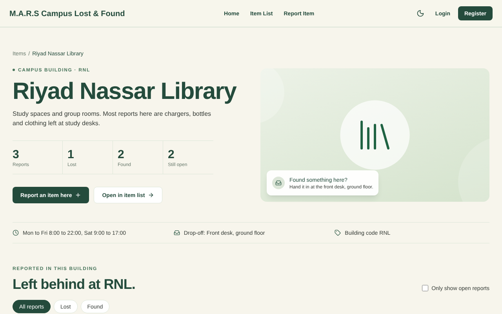 | 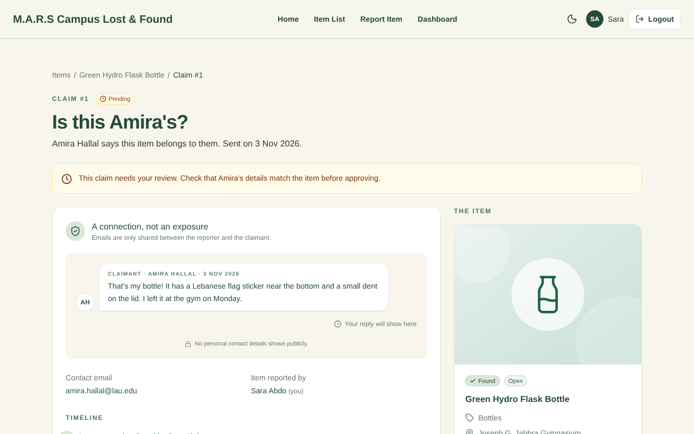 |
| **Approving a claim (modal)** | **Dashboard** |
| 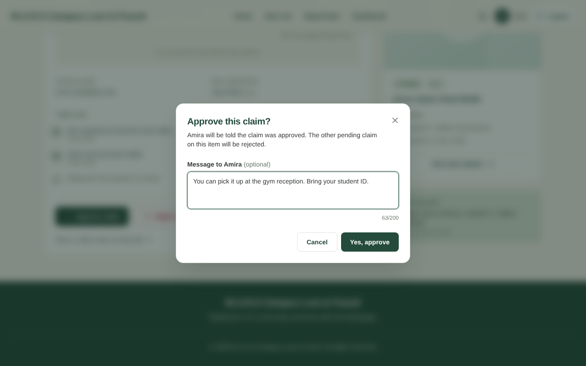 | 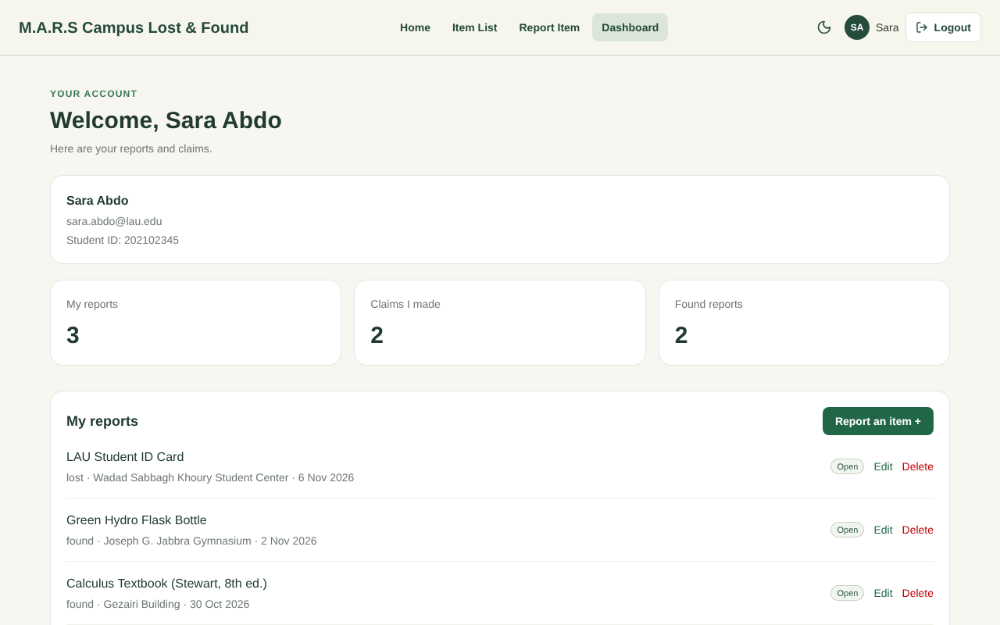 |
| **Login (wrong password)** | **Register (form validation)** |
| 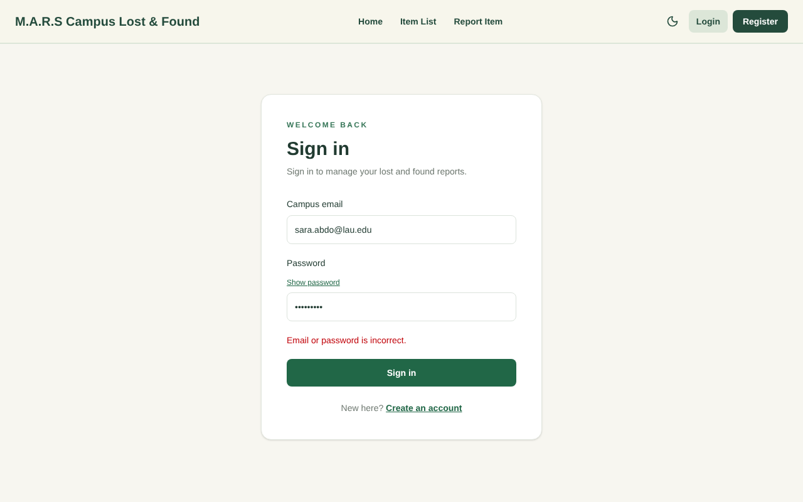 | 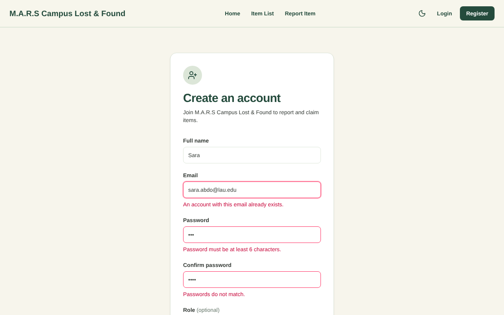 |
| **Dark mode** | |
| 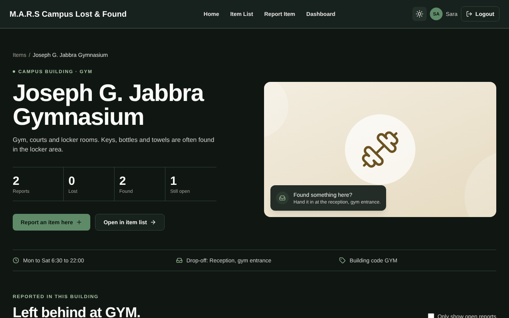 | |

**On a phone**

| Homepage | Location Details |
|---|---|
| 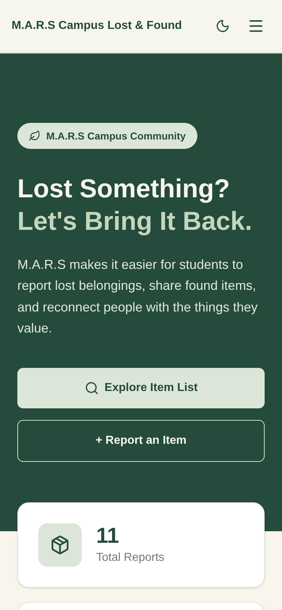 | 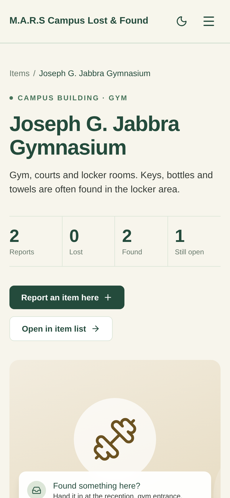 |

## Team

### Phase 1

| Member | Name | Parts |
|--------|------|-------|
| M1 | Roua Youness | Homepage (`/`): designed the homepage layout, hero section, statistics displaying total reports, lost items, and found items, Recent Reports section, and call-to-action section. Connected homepage content to item data. Developed reusable Item Cards displaying item images and information, and connected them to individual item details pages. Implemented simulated item management (adding, editing, and deleting items) using React Context. Developed the reusable Add/Edit Item form with required-field validation. |
| M2 | Sara Abdo | Claim Details (`/claims/:id`): claim message, linked item and timeline, with approve/reject for the reporter and withdraw for the claimant. Location Details (`/locations/:id`): building info, drop-off point, report counts and the items reported there. Also built the Item List page (`ItemList.jsx`) with search and filters. Shared work: mock data (`mockData.js`), shared state (`DataContext`), reusable Modal and ItemTile card, and README screenshots. |
| M3 | Amira Hallal |Login (/login): email and password validation, show/hide password, and sign-in using the shared authentication state. My Reports & Claims Dashboard (/dashboard): displays the signed-in user’s profile, reports they posted, claims they made, and claims on their reports, with links to edit or delete reports and view claim details.|
| M4 | Mariam Abadi | Navbar (links, mobile hamburger menu, login/logout state, and theme toggle), routes in `App.jsx`, Item Details (`/items/:id`), Register (`/register`), 404 page, and deployment+ link added. |

### Phase 2

| Member | Name | Parts |
|--------|------|-------|
| M1 | Roua Youness | |
| M2 | Sara Abdo | |
| M3 | Amira Hallal | Added user registration and login with bcrypt password hashing and JWTs; protected item routes and added ownership checks so users can only edit or delete their own reports; documented authentication in Swagger. |
| M4 | Mariam Abadi | Connected the React pages to the API (`api/client.js`, `DataContext`, `AuthContext`), removed mock-data usage from the frontend, added loading, success and error feedback (`DataGate`, `FeedbackContext`, busy buttons, server validation messages), and updated the README. |
